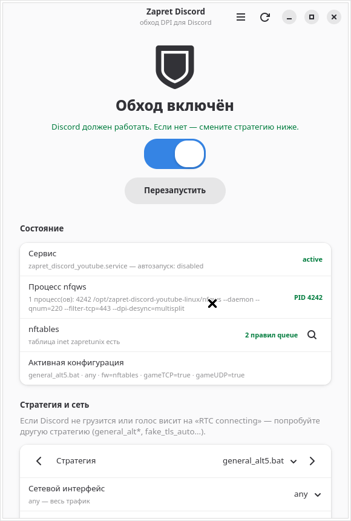
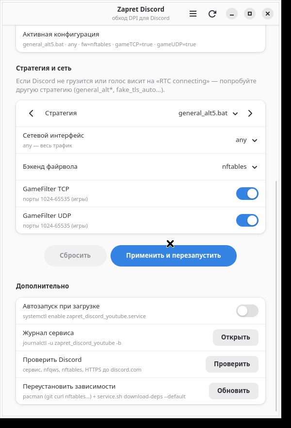
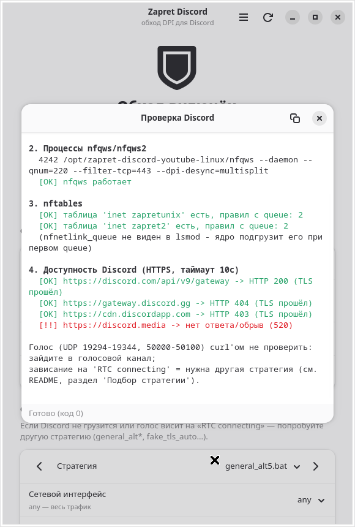

# zapret-discord-arch

**Zapret Discord для Arch Linux** — обход DPI, чтобы Discord (чат и голос) работал в России,
плюс нативное графическое приложение (GTK4 + libadwaita) для включения/выключения и смены стратегий.
Ставится одной командой.



> **Честно о том, что это.** Это **не форк zapret** и не новый движок обхода. Это обёртка для Arch:
> - движок — `nfqws` из [bol-van/zapret](https://github.com/bol-van/zapret);
> - стратегии `general*.bat` — из [Flowseal/zapret-discord-youtube](https://github.com/Flowseal/zapret-discord-youtube) (сборка для Windows);
> - Linux-обвязка (запуск стратегий Flowseal на Linux, nftables, systemd) — [Sergeydigl3/zapret-discord-youtube-linux](https://github.com/Sergeydigl3/zapret-discord-youtube-linux).
>
> **Наше** — установщик под Arch (pacman/makepkg, одна команда, удаление), GTK-приложение с polkit-хелпером
> и Discord-конфиг для запасного варианта на [bol-van/zapret2](https://github.com/bol-van/zapret2).
> Сторонний код в репозитории не хранится: он скачивается при установке с официальных репозиториев авторов.

## Установка одной командой

```bash
git clone https://github.com/levks787-star/zapret-discord-arch.git && cd zapret-discord-arch && ./install.sh
```

Запускайте **без `sudo`** — пароль sudo спросится сам (makepkg от root не работает).
Подходит для Arch Linux, EndeavourOS, Manjaro, CachyOS и других производных с `pacman` и systemd.

Что делает `./install.sh`:

1. Ставит из официальных репозиториев Arch: `git curl nftables grep sed procps-ng`.
2. Клонирует адаптер Sergeydigl3 в `/opt/zapret-discord-youtube-linux` (зафиксированный проверенный коммит).
3. Скачивает `nfqws` (bol-van/zapret v72.9) и стратегии Flowseal рекомендованных версий.
4. Пишет `conf.env` (стратегия `general.bat`, интерфейс `any`, nftables) и включает сервис
   `zapret_discord_youtube.service`.
5. Собирает пакет `zapret-discord-arch` через `makepkg` и ставит его через `pacman`:
   приложение **Zapret Discord** в меню, команда `zapret-discord-gui`, polkit-действие, иконка.

После установки полностью закройте Discord (из трея тоже) и откройте снова. Проверка: `./check.sh`.

### Параметры

| Команда | Что делает |
|---|---|
| `./install.sh` | zapret (вариант A) + сервис + GUI |
| `./install.sh --gui-only` | только GUI (адаптер уже стоит — или поставите кнопкой «Установить» в окне) |
| `./install.sh --no-gui` | только zapret, без GUI |
| `./install.sh --strategy general_alt2.bat` | сразу выбрать другую стратегию |
| `./install.sh --iface wlan0` | работать только на одном интерфейсе (по умолчанию `any`) |
| `./install.sh --no-service` | не создавать systemd-сервис |
| `./install.sh --direct` | GUI без makepkg — просто скопировать файлы в `/usr` |
| `./install.sh --zapret2` | запасной вариант B: AUR-пакет `zapret2` + наш Discord-конфиг (GUI не ставится) |

Для i3 / sway / Hyprland нужен polkit-агент, иначе окно пароля не появится:
`sudo pacman -S polkit-gnome` и добавьте `/usr/lib/polkit-gnome/polkit-gnome-authentication-agent-1` в автозапуск.
В GNOME / KDE / XFCE / Cinnamon агент уже есть.

## Приложение

| Элемент | Что делает |
|---|---|
| Большой переключатель | `systemctl start/stop zapret_discord_youtube.service` |
| Статус | сервис, процесс `nfqws`, таблица nftables `inet zapretunix`, текущий `conf.env` |
| Стратегия (поиск, ‹ ›) | список из `service.sh strategy list` |
| Интерфейс, бэкенд файрвола, GameFilter TCP/UDP | поля `service.sh config set` |
| «Применить и перезапустить» | сохранить настройки и перезапустить сервис |
| Автозапуск | `systemctl enable/disable` |
| Журнал | `journalctl -u zapret_discord_youtube -b` |
| «Проверить Discord» | `scripts/check.sh`: сервис, nfqws, nftables, HTTPS до discord.com / gateway / cdn / discord.media |
| «Установить» | если адаптера ещё нет — `scripts/zapret-install.sh` с выводом в окне |

| Настройки | Проверка |
|---|---|
|  |  |

Права: окно работает от обычного пользователя и пароль не видит. Всё привилегированное делает
`/usr/lib/zapret-discord-arch/zapret-discord-helper` через `pkexec` (polkit-действие
`io.github.zapret_discord_gui.helper`, `auth_admin_keep`). Хелпер принимает только фиксированный набор
команд и проверяет аргументы (стратегия из `strategy list`, существующий интерфейс и т. д.).
Флаги `nfqws` приложение само не придумывает.

## Стратегии

Из Flowseal — **22**: `general.bat`, `general_alt.bat` … `general_alt13.bat`, `general_exp.bat`,
`general_simple_fake*.bat`, `general_fake_tls_auto*.bat`; плюс несколько Linux-стратегий адаптера
(например `general_nix1.bat`). Полный список: `/opt/zapret-discord-youtube-linux/service.sh strategy list`.

Провайдеры режут по-разному. Если Discord не грузится или голос висит на «RTC connecting» — перебирайте:
`general.bat` → `general_alt.bat` … `general_alt13.bat` → `general_simple_fake*.bat` → `general_fake_tls_auto*.bat`.
В GUI: выбрать стратегию → «Применить и перезапустить» → перезапустить Discord. В терминале:

```bash
sudo /opt/zapret-discord-youtube-linux/service.sh config set general_alt5.bat
./check.sh
```

Голос (UDP 443, 19294–19344, 50000–50100) curl'ом не проверить — зайдите в голосовой канал.
Если провайдер блокирует по IP, а не по DPI, zapret не поможет — нужен VPN.

## Удаление

```bash
./uninstall.sh              # GUI + адаптер + сервис + таблица nftables (+ zapret2, если ставили --zapret2)
./uninstall.sh --gui-only   # только приложение
./uninstall.sh --keep-gui   # только zapret
```

## Структура

```
install.sh            единая точка входа (от пользователя, sudo спросит сам)
uninstall.sh          удаляет всё наше
check.sh              диагностика
scripts/
  zapret-install.sh   ядро установки (root): вариант A — адаптер, вариант B — zapret2
  zapret-uninstall.sh ядро удаления (root)
  check.sh            проверки сервиса, nfqws, nftables, Discord
conf/zapret2/         Discord-конфиг и хостлист для варианта B (zapret2)
gui/                  приложение, polkit-хелпер, .policy, .desktop, иконка, PKGBUILD, скриншоты
```

Пакет ставит файлы в `/usr/lib/zapret-discord-arch` (приложение и хелпер) и
`/usr/share/zapret-discord-arch/{scripts,conf}` (те же скрипты, что в репозитории — их вызывает GUI).

### Ручная сборка пакета

`./install.sh --gui-only` делает ровно это: кладёт файлы из `gui/`, `scripts/`, `conf/zapret2/` и `LICENSE`
в одну временную папку рядом с `gui/PKGBUILD` и запускает `makepkg -f`, затем `pacman -U`.

## Важно

- Обход работает не у всех провайдеров — это не гарантия.
- Не ставьте одновременно вариант A и `zapret2`: адаптер при остановке делает `pkill -f nfqws`
  и заденет оба. Установщик и GUI это проверяют.
- `nfqws` скачивается статическим бинарником с GitHub bol-van, а не из pacman.
- Старый пакет `zapret-discord-gui` (ранние сборки) установщик удаляет и заменяет на `zapret-discord-arch`.

## Лицензии и благодарности

Код этого репозитория — **MIT** (см. [LICENSE](LICENSE)).

Используемые при установке проекты (не входят в репозиторий, скачиваются с их GitHub):

| Проект | Что берём | Лицензия |
|---|---|---|
| [bol-van/zapret](https://github.com/bol-van/zapret) | движок `nfqws` | MIT |
| [bol-van/zapret2](https://github.com/bol-van/zapret2) (AUR `zapret2`) | вариант B | MIT |
| [Flowseal/zapret-discord-youtube](https://github.com/Flowseal/zapret-discord-youtube) | стратегии `general*.bat`, списки | MIT |
| [Sergeydigl3/zapret-discord-youtube-linux](https://github.com/Sergeydigl3/zapret-discord-youtube-linux) | Linux-адаптер, `service.sh` | файл лицензии в репозитории не указан — см. репозиторий автора |

Спасибо **bol-van**, **Flowseal** и **Sergeydigl3** — вся магия обхода сделана ими.
